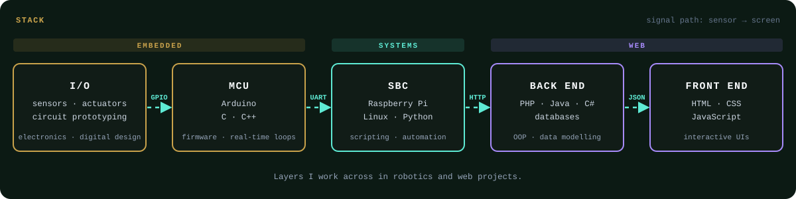
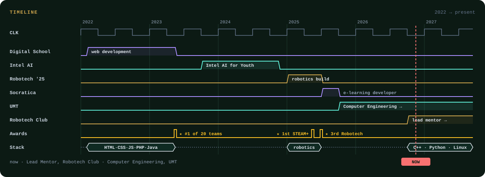

 

 

## About

I'm a computer engineer who works across the stack: microcontroller code in **C/C++**, **Python on Linux** and Raspberry Pi, and web applications in **PHP, Java and JavaScript** backed by SQL databases.

I've shipped web projects for real users and competitions, placed in national robotics and STEM competitions, and I lead the hands-on electronics and embedded-programming sessions at the Robotech Club in Tirana.

 

## Featured project

<table>
<tr>
<td>

### [🐾 Saving Animal Organization](https://github.com/kleamehmeti/saving-animal-organization)

A charity website where visitors read about the organization, create an account and pledge donations to protect animals.

**What it does**
- Account system: sign-up, login and logout, profile editing, password change and account deletion
- Pledges per animal, with each member's history and the total raised per animal
- Members area that only logged-in users can see
- Responsive landing page with tabbed about section, donation goals, partners and gallery

**How it's built**
- PHP 8 back end on MySQL / MariaDB, with the schema in `database/schema.sql` and a one-command setup script
- Passwords hashed with `password_hash()` and checked with `password_verify()`
- Prepared statements for every query, with all output escaped through `htmlspecialchars()`
- CSRF tokens on every form, session ID changed on login, and members can only change their own account
- Database settings come from environment variables, and `includes/` and `database/` are blocked from the web

    

</td>
</tr>
</table>

 

## More work

| Project | Result | What I did |
|:--|:--|:--|
| **Virtual Museum** | 🥇 1st Place, STEAM+ National Competition for Young Talents (2025) | Led the build of an interactive, web-based virtual museum designed for education |
| **Robotics build** | 🥉 3rd Place, Robotech 2025 National Hackathon | Designed and built a robotics project with my team over a five-month competition |
| **Client website** | 🏆 Chosen over 19 other teams, Digital School (2023) | Built the website an international client company selected |
| **Robotech Club** | Lead Mentor (2026 – present) | Run sessions on electronics, circuit prototyping and Arduino / Raspberry Pi projects in C++ and Python on Linux |

 

## Stack

<table>
<tr>
<td><b>Languages</b></td>
<td></td>
</tr>
<tr>
<td><b>Platforms &amp; hardware</b></td>
<td></td>
</tr>
<tr>
<td><b>Foundations</b></td>
<td>object-oriented programming · databases · digital design · electronics · numerical methods · linear algebra · probability</td>
</tr>
</table>

 

## Timeline

<b>Timeline as a table</b>

 

| When | What |
|:--|:--|
| Oct 2026 → | **Lead Mentor**, Robotech Club, Tirana |
| Oct 2025 → | **B.Sc. Computer Engineering**, University Metropolitan Tirana |
| Jul – Oct 2025 | **E-Learning Developer**, Socratica (New York, remote): built STEM courses on LMS / EdTech platforms and iterated on them using learner-engagement data |
| Jun 2025 | 3rd Place, Robotech 2025 National Hackathon |
| May 2025 | 1st Place, STEAM+ National Competition: Virtual Museum |
| Oct 2023 – Nov 2024 | Intel AI for Youth Program |
| 2023 | Client Website Competition winner, Digital School |
| Feb 2022 – May 2023 | **Software Development Track**, Digital School, Skopje: web developer, front-end and back-end programs (HTML, CSS, JavaScript, PHP, Java) |

 

## GitHub

  
  

 

## Contact

Open to software and embedded developer roles, on-site in Tirana or remote. I work in Albanian, English and Turkish, with working German.

